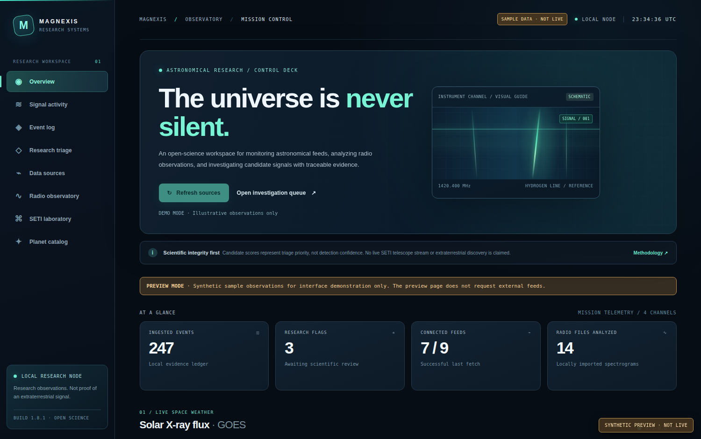
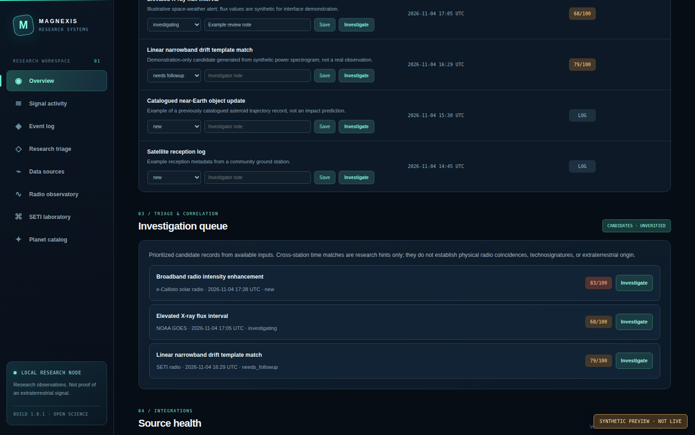
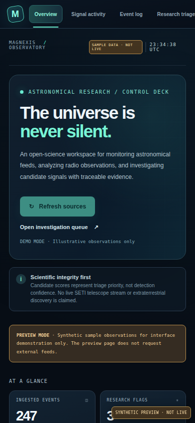
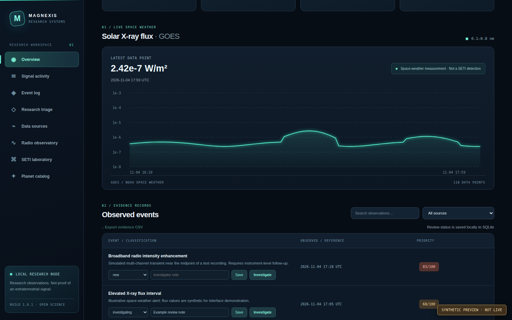
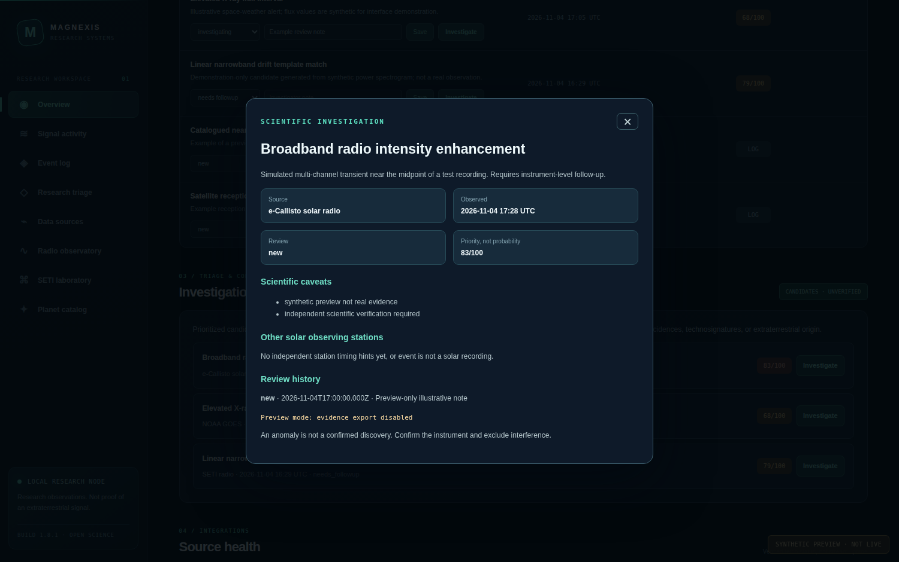
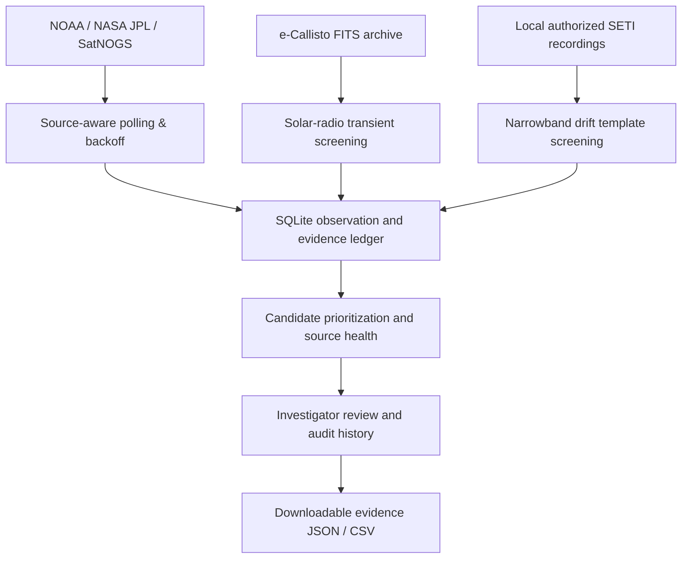

<div align="center">

# MAGNEXIS / SIGNALWATCH

**An astronomical anomaly observatory built for evidence-first research.**

Monitor public space-weather observations, inspect solar-radio spectrograms, and triage unverified radio candidates from a single local command center.

   [](https://github.com/theworker02/signalwatch/actions/workflows/tests.yml)

[Quick start](#quick-start) · [Interface](#interface-gallery) · [How it works](#how-signalwatch-works) · [Research integrity](#research-integrity) · [API](#api-and-operator-tools)

</div>

> [!IMPORTANT]
> **SIGNALWATCH is experimental research software, not an extraterrestrial detection service.** It does **not** confirm technosignatures, discover planets, forecast asteroid impacts, or independently establish the origin of a radio burst. Scores indicate investigation priority—not the probability that an event is artificial or extraterrestrial. There is no continuously streaming distant-target SETI telescope connected to this release.

## Interface gallery

**Mission control — desktop**



<table><tr><td width="67%">

**Research triage:** inspect candidate records, compare sources, and investigate anomalies.


</td><td width="33%">

**Mobile workspace:** adaptive sidebar, metrics, and research status.


</td></tr></table>

**Solar monitoring**



**Investigation detail**



*All screenshots show the **opt-in synthetic preview dataset** (`?preview=1`). They document the actual HTML/CSS/JS interface, not live observations, discovered signals, or verified source availability. Screenshot capture does not write demonstration data into the research database.*

## Capabilities

| Area | What it does | Scientific boundary |
|---|---|---|
| **Space weather** | Monitors public NOAA GOES X-ray, solar flux, flare, and Kp measurements | Solar and geomagnetic activity, **not SETI** |
| **Solar radio** | Periodically discovers recent e-Callisto FITS archives, downloads bounded recordings, screens broadband temporal enhancements | Solar targets; anomalies require RFI and instrument checks |
| **Narrowband SETI laboratory** | Analyzes locally imported power spectrograms (`.npy`, `.npz`, optional `.fil` and `.h5`) for drifting narrowband traces | Archived/imported files, **not live telescope streaming** |
| **Satellite observations** | Retrieves SatNOGS observation metadata | Metadata does not provide a validated RF signal |
| **Solar-system context** | Retrieves NASA/JPL close-approach predictions for already catalogued objects | Not an asteroid discovery or impact-warning engine |
| **Known planets** | Reads NASA Exoplanet Archive reference records | No new exoplanet detection |
| **Research operations** | Candidate triage, append-only review history, evidence JSON/checksums, CSV export, source freshness, SQLite persistence | Human review and independent scientific validation required |

Data providers update on different schedules. *Continuous operation* means that the local service **periodically polls eligible public sources**, subject to their publication delays and rate limits; it does not imply continuous RF sampling of the sky.

## Quick start

**Requirements:** Python 3.10 or newer; internet access for public feeds; a modern browser. There are **no paid API keys** required for the default integrations.

```bash
# Clone the repository
git clone https://github.com/theworker02/signalwatch.git
cd signalwatch

# Create an isolated Python environment
python -m venv .venv

# macOS / Linux
source .venv/bin/activate
# Windows PowerShell, instead use: .venv\Scripts\Activate.ps1

python -m pip install -r requirements.txt
python -m signalwatch.cli doctor
python run.py
```

Open **http://127.0.0.1:8765**. On Windows you can also use `start_windows.bat`. The server binds to loopback by default—no public deployment is implied.

### Docker Compose

```bash
docker compose up -d --build
docker compose logs -f
```

Docker exposes the UI only at **127.0.0.1:8765** and persists observations under `./data/`. The local computer or host must remain running for ongoing polling.

### Optional radio analysis dependencies

```bash
python -m pip install -r requirements-radio.txt
python -m signalwatch.radio /path/to/on_target.fil --off /path/to/off_target.fil
```

Alternatively, place *authorized, actual recorded power spectrograms* into `data/inbox/`. Supported paths include `.npy`, `.npz`, and—when `blimpy` is installed—`.fil` and `.h5`. The service watches the inbox roughly every 20 seconds. Very large recordings are analyzed using a bounded cutout; the entire original band is **not** searched in that case.

For educational validation only:

```bash
python -m signalwatch.radio --demo
python -m examples.make_synthetic
```

Synthetic input is always test data, never scientific evidence.

## How SIGNALWATCH works



1. **Ingest conservatively.** Each source has distinct polling intervals, bounded downloads, and retry/backoff behavior; health status reveals errors and stale results.
2. **Keep science channels separate.** Solar-radio broadband transients are not treated as distant-target SETI observations. Satellite metadata and exoplanet catalog entries are contextual records.
3. **Score for triage, not certainty.** The radio detector performs robust row normalization and tests linear-frequency drift patterns. Near-zero drift and matching off-target recordings are flagged as possible terrestrial interference.
4. **Preserve the evidence.** Investigation status and notes are stored in SQLite. Exported JSON contains observation metadata, caveats, review history, source status, and a canonical SHA-256 checksum for tamper detection. A checksum is **not** a scientific certificate.
5. **Demand independent verification.** True technosignature research requires telescope pointing, calibrated frequency/time axes, instrument characterization, off-target controls, and independent follow-up.

### Source cadences and limits

| Integration | Approximate schedule | Limits and notes |
|---|---|---|
| NOAA SWPC feeds | 5–10 minutes | Recent published measurements; publication and processing can lag |
| e-Callisto archive + upload index | ~15 minutes | At most 2 small recent FITS files per cycle; auto-cache size limits apply |
| SatNOGS | ~10 minutes | Observation metadata; not raw RF spectra |
| NASA/JPL | ~6 hours | Conservatively cached close-approach predictions |
| NASA Exoplanet Archive | Daily | Bounded confirmed-planet reference snapshot |
| Local radio inbox | ~20 seconds | File watcher on locally supplied power spectrograms |

Source cooldowns may extend after failures. These intervals are implementation defaults, not provider guarantees.

## Research integrity

**What a flag means:** a programmatic heuristic found a pattern worth inspection. **What a flag does not mean:** discovery of a planet, a transmitter, an extraterrestrial civilization, an independently verified solar burst, or an operational risk alert.

A credible investigation should check instrument configuration and calibration, remove narrowband local interference, compare ON/OFF sky pointing data where available, examine alternate observing stations with aligned frequency/time metadata, and preserve raw observations for independent review.

The cross-station solar timing correlator returns **timing hints**, not physical confirmation. The NASA exoplanet catalog is reference material. A new entry in SIGNALWATCH's local database is **not** a newly discovered planet. e-Callisto telescope observations are **solar observations** and must not be presented as SETI detections.

**Validation as of v1.8.1:** Local pytest and browser-preview checks pass. The browser preview uses fixed synthetic observations. A real end-to-end e-Callisto FITS download and decode was **not** verified from this isolated build environment. The original `v1.8` test suite contains an Astropy-dependent FITS test that may skip when its optional dependency is missing. Source health in your own deployment is the source of truth.

## Operations and configuration

| Environment variable | Default | Purpose |
|---|---|---|
| `SIGNALWATCH_BACKGROUND` | `1` | Enable periodic public polling and local-file scanning |
| `SIGNALWATCH_POLL_SECONDS` | `300` | Background scheduler interval (minimum 60 seconds) |
| `SIGNALWATCH_CALLISTO_DOWNLOAD` | `1` | Enable bounded FITS auto-downloading |
| `SIGNALWATCH_CALLISTO_STATION` | `AUTO` | Select stations for published solar observations |
| `SIGNALWATCH_DATA_DIR` | `./data` | SQLite database, watched inbox, and research backups |
| `SIGNALWATCH_WRITE_TOKEN` | unset | Optional token for mutation endpoints (not full user authentication) |

```bash
python -m signalwatch.cli doctor
python -m signalwatch.cli poll
python -m signalwatch.cli scan
python -m signalwatch.cli alerts --min-score 60
python -m signalwatch.cli backup
python -m pytest -q
```

**Security:** This application is designed for local operation. It does not include public-user authentication, per-user authorization, an internet-safe reverse-proxy configuration, or a hardened multi-tenant security model. Keep the default loopback binding, protect source recordings, and do not expose the API publicly without additional controls. Never commit secrets or private recordings.

### Safe preview mode

`http://127.0.0.1:8765/?preview=1` renders **illustrative synthetic observations** in the client only. The page is visibly labeled `SAMPLE DATA · NOT LIVE`. The preview **page** does not fetch live data, persist records, save investigator notes, or export synthetic evidence; if the server background scheduler is enabled, it continues independently. Remove `?preview=1` to see actual locally ingested data.

To reproduce the screenshot assets (developer tooling only):

```bash
python -m pip install playwright
python -m playwright install chromium
python scripts/capture_screenshots.py
```

The screenshots are generated from the shipped HTML/CSS/JavaScript in a headless Chromium browser, with a fixed synthetic dataset and no outside requests. The included GitHub workflow can regenerate them after frontend changes.

## API and operator tools

| Method | Endpoint | Use |
|---|---|---|
| `GET` | `/api/health`, `/api/status`, `/api/telemetry` | Service health, counts, and freshness |
| `GET` | `/api/sources` | Feed health and last errors |
| `GET` | `/api/events`, `/api/events/changes` | Investigations and append-only additions |
| `GET` | `/api/alerts?min_score=60` | Triage queue (excludes synthetic test records) |
| `GET` | `/api/events/{id}` | Observation, history and cautious station matches |
| `GET` | `/api/events/{id}/evidence.json`, `/api/events.csv` | Research evidence exports |
| `PATCH` | `/api/events/{id}/review` | Update review state and append audit history |
| `GET` | `/api/samples`, `/api/radio/observations`, `/api/radio/files` | Measurements and radio-file metadata |
| `GET` | `/api/exoplanets` | Known planet reference catalog |
| `POST` | `/api/poll` | Request an eligible polling cycle |

FastAPI provides interactive documentation at `/docs`. Polling remains subject to cooldowns. Full API and configuration details are in the source modules under [`signalwatch/`](signalwatch/).

## Repository layout

```text
signalwatch/
├── signalwatch/               # Data sources, radio analytics, storage, research APIs
├── static/                    # Responsive dashboard; browser-only preview dataset
├── docs/screenshots/          # Real browser captures with visibly synthetic preview data
├── scripts/                   # Reproducible screenshot capture tool
├── tests/                     # Unit, integration and scientific-boundary regression tests
├── examples/                  # Synthetic algorithm validation helpers
├── .github/workflows/         # Continuous testing and screenshot generation
├── Dockerfile
├── docker-compose.yml
├── requirements*.txt
└── README.md
```

## Data sources and attribution

This project is **independent of** the organizations providing public observations. Follow each dataset's applicable terms before use or publication.

- [e-Callisto](https://www.e-callisto.org/Data/data.html): solar radio data from contributing observatories; follow the network's credit and publication guidance and consult relevant observers as required.
- [NOAA Space Weather Prediction Center](https://www.swpc.noaa.gov/): published X-ray, geomagnetic, and radio-flux products.
- [NASA JPL Small-Body Database / CAD](https://ssd-api.jpl.nasa.gov/doc/cad.html): catalogued small-body trajectory predictions.
- [SatNOGS](https://network.satnogs.org/): ground-station observation metadata and community infrastructure.
- [NASA Exoplanet Archive](https://exoplanetarchive.ipac.caltech.edu/): reference data about previously catalogued and confirmed planets.
- [Breakthrough Listen](https://seti.berkeley.edu/opendata): public archived distant-target SETI recordings for investigator-controlled import.

## Project status and contributions

SIGNALWATCH is currently an **experimental local research prototype**. It is not a hosted 24/7 service and it does not currently offer independently verified live SETI telescope ingestion. The next milestones are: verifying real FITS metadata/decoding end-to-end, obtaining an expressly authorized continuously updating distant-target stream, and improving time/frequency calibration and independent interference rejection.

For security concerns, see [SECURITY.md](SECURITY.md). For local development and issue guidelines, see [CONTRIBUTING.md](CONTRIBUTING.md).

**Licensing:** A public GitHub repository does not by itself grant reuse rights. A license has not yet been selected for this project; please contact Magnexis before distributing derivative works.

---

<div align="center"><sub>Made by <strong>Magnexis LLC</strong> · © 2026 Magnexis LLC · Evidence before conclusions.</sub></div>
